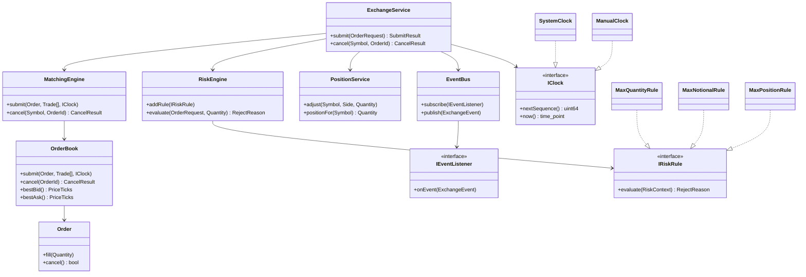
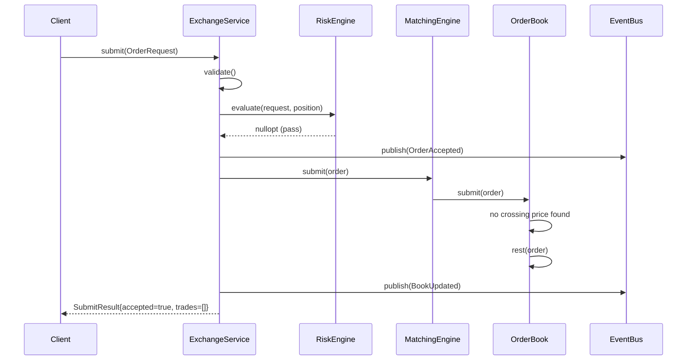
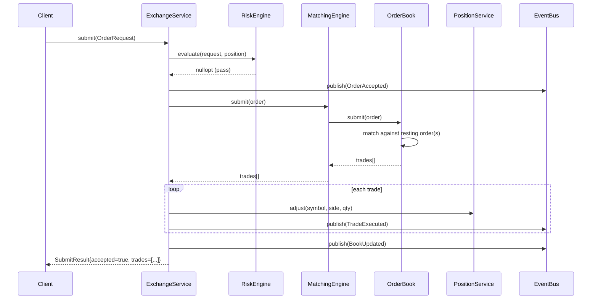

# Interview Learning Guide

This is the single point of truth for revising MiniQuantExchange before a
C++/LLD interview. Read it top to bottom for a full pass, or jump to the
concept-to-code index (§3) to find where a specific topic lives.

All line references were captured with `nl -ba` against the final code and
are stable unless noted; if a file has since changed, the symbol names
given alongside each reference are the reliable fallback locator.

---

## 1. 60–90 minute revision route

Work through in order. For each step, you should be able to close the file
and explain the listed points out loud without notes.

1. **Domain flow (10 min)** — Read this guide's §2 architecture walkthrough
   and README's "Supported order flow". Be able to narrate: client submits
   a request → validation → risk → matching → position update → events.
2. **`Order` and value types (10 min)** — `include/miniq/types.hpp`,
   `include/miniq/order.hpp`, `include/miniq/strong_id.hpp`. Explain why
   `OrderRequest` and `Order` are separate types, why `Symbol`/`StrongId`
   validate/constrain their values, and `Order`'s fill/cancel invariants.
3. **`OrderBook` (15 min)** — `include/miniq/order_book.hpp`,
   `src/order_book.cpp`. Explain the container choices (§6 of
   DESIGN_DECISIONS.md), price-time priority, the matching loop, and why
   cancellation is O(1) average.
4. **Risk abstraction (10 min)** — `include/miniq/risk.hpp`, `src/risk.cpp`.
   Explain `IRiskRule` as Strategy/OCP, and walk through
   `MaxNotionalRule`'s overflow guard.
5. **`ExchangeService` (10 min)** — `include/miniq/exchange_service.hpp`,
   `src/exchange_service.cpp`. Explain constructor injection/DIP, the
   submit() pipeline order, and why rejection is a return value not an
   exception.
6. **Event/lifetime ownership (10 min)** — `include/miniq/event_bus.hpp`,
   `include/miniq/events.hpp`. Explain Observer via `weak_ptr`, and why
   `std::variant`+`std::visit` was chosen over a class hierarchy.
7. **Tests (10 min)** — skim `tests/*.cpp`. Pick three test names and
   explain, from the name alone, what behavior each protects.
8. **Playground copy/move (10 min)** — `playground/copy_move_raii.cpp`.
   Be able to draw the Rule of Five from memory and explain why the
   production code doesn't need it.
9. **Concurrency/systems discussion (10 min)** — `playground/concurrency.cpp`
   and DESIGN_DECISIONS.md §3 and §10. Be ready for "how would you make
   this production/low-latency."
10. **SOLID/LLD recap (5–10 min)** — §4 and §5 below. Be able to state each
    SOLID letter's project example in one sentence.

---

## 2. Architecture walkthrough

**Major components** (one primary responsibility each — SRP):

| Component | File | Responsibility |
|---|---|---|
| `Order` | `include/miniq/order.hpp:31` | Live, stateful order; owns fill/cancel invariants |
| `OrderBook` | `include/miniq/order_book.hpp:26` | Price-time priority matching for one symbol |
| `MatchingEngine` | `include/miniq/matching_engine.hpp:13` | Routes orders to the right symbol's `OrderBook` |
| `IRiskRule` / `RiskEngine` | `include/miniq/risk.hpp:26,74` | Pre-trade risk policy (Strategy, OCP) |
| `PositionService` | `include/miniq/position_service.hpp:17` | Net position per symbol |
| `EventBus` / `IEventListener` | `include/miniq/event_bus.hpp:13,25` | Observer/Pub-Sub broadcast |
| `ExchangeService` | `include/miniq/exchange_service.hpp:38` | Orchestration boundary (DIP) |
| `IClock` | `include/miniq/clock.hpp:14` | Deterministic time/sequence (DIP, testability) |
| `ITradingStrategy` | `include/miniq/strategy.hpp:21` | Example Strategy consuming top-of-book |

**Ownership.**
`ExchangeService` holds references (not ownership) to `MatchingEngine`,
`RiskEngine`, `PositionService`, `EventBus`, `IClock` — all are
constructed and owned by the caller (e.g. `main.cpp` or a test `Fixture`)
and injected via the constructor. `MatchingEngine` owns its `OrderBook`s
directly (by value, in an `unordered_map`) since `OrderBook` is move-only
and nothing else needs to share it. `RiskEngine` owns its rules via
`unique_ptr<IRiskRule>` (exclusive ownership). `EventBus` does **not** own
its listeners — it holds `weak_ptr`s so a listener's real owner controls
its lifetime.

**Dependency arrows** (who depends on whom, never the reverse):
```
main.cpp / tests
      |
      v
ExchangeService --> MatchingEngine --> OrderBook
      |         --> RiskEngine --> IRiskRule (impls)
      |         --> PositionService
      |         --> EventBus --> IEventListener (impls)
      +-------> IClock (impl)
```
Nothing below `ExchangeService` depends upward on it — this is the
Dependency Inversion in action: `ExchangeService` is the only thing that
knows about all the pieces; each piece only knows its own narrow
interface.

**End-to-end order flow** — see `ExchangeService::submit`
(`src/exchange_service.cpp:16`):
1. `validate()` — quantity/price sanity.
2. Duplicate-ID check against `knownOrderIds_`.
3. `RiskEngine::evaluate()` against current position.
4. Construct `Order`, publish `OrderAccepted`.
5. `MatchingEngine::submit()` — matches and/or rests the order.
6. For each resulting `Trade`: adjust position, publish `TradeExecuted`.
7. Publish a final `BookUpdated` with fresh best bid/ask.

**Book invariants** (enforced by `OrderBook`, see
`docs/DESIGN_DECISIONS.md` §2 and §9 Step C in this guide):
- `0 <= remainingQuantity <= originalQuantity` for every live order.
- A price level is never left empty in `bids_`/`asks_` — it's erased the
  moment its last order leaves (see `src/order_book.cpp`'s `matchAgainst`
  and `cancel`).
- A filled/cancelled order is never left in `locators_`.
- FIFO within a price level is preserved: a partial fill does **not** move
  a resting order to the back of its level.

**Event flow.** Every state change `ExchangeService` makes is followed by
a publish through `EventBus` in the same call — there's no separate
"flush events" step, so a caller can rely on having seen every event for
a given `submit()`/`cancel()` call by the time that call returns.

---

## 3. Concept-to-code index

Every mandatory topic from the project brief, with its home in this repo.
Playground-only concepts are marked `playground`.

### C++ fundamentals

| Concept | Simple definition | File | Symbol | Why used here | Pitfall |
|---|---|---|---|---|---|
| Compilation units | One `.cpp` + the headers it includes, compiled independently | `src/*.cpp` + `include/miniq/*.hpp` | — | Standard header/source split | Forgetting `#pragma once` causes multiple-definition errors |
| `#pragma once` | Include guard alternative | every header | line 1 of each `.hpp` | Simpler than `#ifndef` guards | Not 100% portable across obscure toolchains (non-issue here) |
| Namespaces | Scope to avoid name collisions | all headers | `namespace miniq { ... }` | Keeps `Order`, `Symbol` etc. out of global namespace | Overly deep nesting hurts readability (avoided here — one flat `miniq` namespace) |
| `auto` | Compiler-deduced type | `playground/cpp_fundamentals.cpp:63` | `auto count = 5;` | Reduces redundant type spelling | Can obscure the actual type at a glance |
| `const` / `constexpr` | Runtime-fixed vs compile-time-fixed value | `playground/cpp_fundamentals.cpp:59-62` | `runtimeConst`, `compileTimeConst` | `constexpr` enables `static_assert` | Using `const` where `constexpr` is possible misses compile-time checks |
| `static` | File/class-local storage or shared state | `include/miniq/clock.hpp:34` | `SystemClock::sequence_` (instance, not `static`) — contrast with a `static` counter if shared across instances were wanted | miniq intentionally avoids shared mutable `static` state | Global/static mutable state is a common source of hidden coupling |
| Signed/unsigned + overflow | Integer wraparound and comparison pitfalls | `src/risk.cpp:19-24` | `MaxNotionalRule::evaluate` overflow guard | Prevents notional overflow from silently passing risk | Comparing signed/unsigned without casting causes silent promotion bugs |
| Pointers / references / `nullptr` | Non-owning access | `include/miniq/exchange_service.hpp:60-64` | `MatchingEngine&` etc. | References for guaranteed-non-null collaborators | Dangling reference if caller destroys dependency early |
| Pass by value/reference/const-ref | Parameter-passing cost/mutability trade-offs | `include/miniq/exchange_service.hpp:48` | `submit(const OrderRequest&)` | Avoids copying a request just to read it | Passing large types by value when const-ref would do |
| Return by value | NRVO/move-friendly return | `src/strategy.cpp:5-16` | `PassiveJoinStrategy::onMarketData` returns `std::optional<OrderRequest>` by value | Simple ownership semantics, compiler elides the copy | Returning a reference to a local — obvious UB, avoided everywhere here |
| lvalues/rvalues | Named/addressable vs temporary | `src/order_book.cpp:100,105` | `level.orders.push_back(std::move(order))` | Signals "I'm done with this value, take it" | Using `std::move` on something still needed afterward |
| Implicit/explicit conversion | Automatic vs `static_cast`-marked conversion | `src/risk.cpp` | `static_cast<std::int64_t>` (overflow guard) | Explicit casts make lossy/widening conversions visible | Relying on implicit narrowing conversions |
| `enum class` | Scoped enum, no implicit int conversion | `include/miniq/types.hpp` | `enum class Side`, `OrderType`, etc. | Prevents `Side::Buy == OrderType::Limit` type confusion | Plain `enum` pollutes the enclosing scope with its enumerators |
| Structured bindings | Unpack a pair/tuple/struct into named variables | `playground/templates_stl.cpp` | `for (const auto& [price, label] : descendingPrices)` | Readable iteration over `map` entries | Binding by value when a reference was intended (extra copies) |
| Range-for | Iterate a container without manual iterators | `src/event_bus.cpp:12` | `for (auto& weakListener : listeners_)` | Concise, less error-prone than index loops | Modifying a container while range-for iterates it |
| Lambdas/captures | Inline callable with captured state | `include/miniq/order_book.hpp` (via STL algorithm use in tests/playground) | `playground/cpp_fundamentals.cpp` capture examples | Compact predicate/callback definitions | By-reference capture outliving the captured variable |

### Functions / classes

| Concept | File | Symbol | Notes |
|---|---|---|---|
| Function overloading | `playground/templates_stl.cpp` | `describe(int)`/`describe(double)` | Resolved at compile time by argument type |
| Constructors / member init lists | `include/miniq/order.hpp:33-42` | `Order::Order(...)` | All members initialized in the list, none default-then-assigned |
| Copy/move constructor+assignment | `playground/copy_move_raii.cpp` | `Buffer` | The one manual Rule-of-Five example; production code uses Rule of Zero instead |
| Destructor | `playground/copy_move_raii.cpp` | `~Buffer()` | Production classes rely on member destructors (Rule of Zero) |
| `= default` / `= delete` | `include/miniq/order_book.hpp` | `OrderBook(const OrderBook&) = delete;` / `OrderBook(OrderBook&&) = default;` | Explicitly documents move-only intent |
| `explicit` | `include/miniq/types.hpp` | `explicit Symbol(std::string code)` | Prevents an implicit `std::string` → `Symbol` conversion |
| `const` member functions | throughout | e.g. `Order::id() const noexcept` | Documents/enforces no mutation |
| `static` member/function | `include/miniq/clock.hpp` | (not used for shared state by design — see fundamentals table) | — |
| Operator overloading | `include/miniq/strong_id.hpp:23` | `operator<=>` (defaulted) | One sensible, small use — spaceship operator for ID comparison |
| `friend` | `include/miniq/strong_id.hpp:23` | `friend constexpr auto operator<=>` | Only used because a defaulted non-member comparison needs it; not used elsewhere |

### Lifetime / resource management

| Concept | File | Symbol | Notes |
|---|---|---|---|
| RAII | `include/miniq/clock.hpp`, `playground/concurrency.cpp` | `std::lock_guard` | Lock acquired/released by scope, not manually |
| `std::unique_ptr` | `include/miniq/risk.hpp:79` | `RiskEngine::rules_` | Exclusive ownership of heterogeneous rule objects |
| `std::shared_ptr`/`std::weak_ptr` | `include/miniq/event_bus.hpp` | `EventBus::listeners_` | Non-owning broadcast; see DESIGN_DECISIONS.md §7 |
| `std::make_unique` | `src/main.cpp` | `std::make_unique<MaxQuantityRule>(...)` | Exception-safe construction |
| Rule of Zero | `include/miniq/order.hpp`, `include/miniq/trade.hpp` | whole classes | No manual special members needed |
| Rule of Five | `playground/copy_move_raii.cpp` | `Buffer` | Playground-only, contrasted with Rule of Zero |
| Moved-from state | `playground/copy_move_raii.cpp` | comment after `Buffer c(std::move(a))` | `a` is valid-but-unspecified after the move |
| Dangling reference risk | `include/miniq/event_bus.hpp` | why `weak_ptr` is used instead of a raw pointer/reference | Avoided by design, not just documented |
| Double delete | `playground/copy_move_raii.cpp` | comment inside `Buffer` | Explains why move ops must null out the source pointer |

### OOP

| Pillar | File | Symbol |
|---|---|---|
| Encapsulation | `include/miniq/order.hpp` | private `remainingQuantity_`/`status_`, mutated only via `fill()`/`cancel()` |
| Abstraction | `include/miniq/risk.hpp` | `IRiskRule` — callers only see `evaluate()` |
| Inheritance | `include/miniq/risk.hpp` | `MaxQuantityRule : IRiskRule` |
| Polymorphism (runtime) | `src/risk.cpp` | `RiskEngine::evaluate` calling through `IRiskRule*` |
| Polymorphism (compile-time) | `include/miniq/strong_id.hpp` | `template <typename Tag> class StrongId` |
| Composition over inheritance | `include/miniq/exchange_service.hpp` | `ExchangeService` *has-a* `MatchingEngine&` etc., is-not-a any of them |
| Object slicing | `playground/polymorphism.cpp` | comment near `Shape` | Explained via why it's structurally avoided (abstract base) |
| Virtual destructor | `include/miniq/risk.hpp:27`, `include/miniq/clock.hpp:16` | `virtual ~IRiskRule() = default;` | Required for safe polymorphic deletion through a base pointer |
| `override` | throughout | every derived virtual | Catches signature mismatches at compile time |
| `final` | `include/miniq/order_book.hpp`, playground `Circle final` | prevents further derivation |
| Multiple inheritance / diamond | `playground/polymorphism.cpp` | `struct Bottom : Left, Right` (`playground` only) |

### Casts

| Cast | File | Symbol | Note |
|---|---|---|---|
| `static_cast` | `src/risk.cpp` | overflow guard division | Safe, intentional widening/narrowing |
| `dynamic_cast` | `playground/polymorphism.cpp` | `dynamic_cast<Circle*>(basePtr)` | `playground` — safe downcast, and why it's usually avoidable |
| `const_cast` | not used in production code | — | Deliberately avoided; would only be reached for in rare legacy-API scenarios |
| `reinterpret_cast` | not used anywhere | — | No low-level type punning needed in this project |

### Templates / generic programming

| Concept | File | Symbol |
|---|---|---|
| Function template | `playground/templates_stl.cpp` | `template <typename T> const T& maxOf(...)` |
| Class template | `include/miniq/strong_id.hpp` | `template <typename Tag> class StrongId` |
| `std::less`/`std::greater` | `include/miniq/order_book.hpp` | `std::map<PriceTicks, PriceLevel, std::greater<>>` |
| Template type deduction | `playground/templates_stl.cpp` | `maxOf(3, 7)` deduces `T=int` |

### STL

See §5 (STL complexity cheat sheet) for the full table with complexity and
invalidation notes.

### Modern C++ correctness

| Concept | File | Symbol |
|---|---|---|
| `std::move` | `src/order_book.cpp` | `level.orders.push_back(std::move(order))` |
| `noexcept` | `include/miniq/clock.hpp` | `nextSequence() noexcept` |
| `[[nodiscard]]` | `include/miniq/exchange_service.hpp` | `[[nodiscard]] SubmitResult submit(...)` |
| `using` aliases | `include/miniq/types.hpp` | `using PriceTicks = std::int64_t;` |
| `std::chrono` | `include/miniq/clock.hpp` | `std::chrono::system_clock::time_point` |
| `std::optional` | `include/miniq/order.hpp` | `std::optional<PriceTicks> limitPrice_` |
| `std::variant`/`std::visit` | `include/miniq/events.hpp`, `src/main.cpp` | `ExchangeEvent`, `ConsolePrinter::onEvent` |
| const-correct APIs | throughout | nearly every accessor is `const noexcept` |

---

## 4. SOLID section

For each principle: definition, project example, how the design would
violate it, how the current design fixes it, when following it too
literally becomes overengineering, and two interview questions.

### S — Single Responsibility Principle

**Definition.** A class should have one reason to change.

**Project example.** `OrderBook` only handles book state/matching
invariants; `RiskEngine` only coordinates risk checks; `PositionService`
only tracks positions; `EventBus` only distributes events.

**Violation.** A "God `Exchange` class" that validates requests, matches
orders, tracks risk *and* positions, and formats console output all in one
class — a change to how positions are stored would risk breaking matching
logic that happens to live in the same file.

**Fix.** Each responsibility above is a separate class with a narrow
public surface; `ExchangeService` composes them but implements none of
their internals itself.

**Overengineering risk.** Splitting `Order`'s six-line `fill()` and
`cancel()` methods into separate `OrderFiller`/`OrderCanceller` classes
would be SRP taken past the point of usefulness — a class can (and should)
have more than one *method* as long as it has one *reason to change*.

**Interview questions.**
1. "What's the difference between SRP and 'a class should only have one
   method'?" — SRP is about reasons to change, not method count.
2. "Where in this codebase would you say SRP is deliberately *not* pushed
   further, and why?" — `Order` owns both its data and its fill/cancel
   invariants; splitting those apart would separate tightly-coupled state
   and behavior for no real benefit.

### O — Open/Closed Principle

**Definition.** Open for extension, closed for modification.

**Project example.** New risk checks are added by implementing
`IRiskRule` (`include/miniq/risk.hpp:26`) and calling
`RiskEngine::addRule` — `RiskEngine` itself never changes. Similarly, new
strategies implement `ITradingStrategy` without touching
`ExchangeService`.

**Violation.** If `RiskEngine::evaluate` were a big `if/else if` chain
checking `rule.type == "max_quantity"` etc., adding a rule would require
editing that function directly, risking breaking existing checks.

**Fix.** `RiskEngine` only knows `IRiskRule::evaluate()`; it never needs
to know how many or which concrete rules exist.

**Overengineering risk.** Speculatively creating an `IRiskRule` for
something that will only ever have one implementation adds an interface,
a vtable, and a header for no real extension point.

**Interview questions.**
1. "How do you add a `MinQuantityRule` without editing `RiskEngine`?" —
   implement `IRiskRule`, call `addRule`.
2. "When is OCP not worth it?" — when a "closed" behavior genuinely never
   varies; forcing an interface onto a single, stable implementation adds
   indirection with no payoff.

### L — Liskov Substitution Principle

**Definition.** Subtypes must be substitutable for their base type
without breaking caller correctness — behavioral, not just structural,
compatibility.

**Project example.** Every `IRiskRule` implementation must be a pure,
side-effect-free check returning `std::nullopt` or a `RejectReason` purely
from the given `RiskContext` — `RiskEngine::evaluate` relies on this to
call rules in any order without surprises. Every `IClock` (`SystemClock`,
`ManualClock`) must satisfy "sequence numbers strictly increase" —
`OrderBook`'s FIFO tie-breaking depends on this holding for *either* clock.

**Violation.** An `IRiskRule` implementation that mutates external state
(e.g. logs a side-channel warning that later rules depend on) would break
`RiskEngine`'s assumption that rule order doesn't matter for correctness.
A hypothetical `IClock` whose `nextSequence()` could occasionally return a
lower value than a previous call would silently break FIFO ordering.

**Fix.** The contract is documented at the interface (see the comments in
`include/miniq/risk.hpp` and `include/miniq/clock.hpp`), and both existing
implementations honor it.

**Overengineering risk.** N/A here — LSP violations are bugs, not a
"too much LSP" situation; there's no such thing as being overly
substitutable.

**Interview questions.**
1. "Isn't LSP just 'inheritance works'?" — no; a class can compile fine as
   a subtype and still violate LSP by breaking a *behavioral* contract
   (e.g. throwing where the base never did, or violating a documented
   invariant).
2. "Give an example from this codebase where LSP matters in a test." —
   `ManualClock` must be substitutable for `SystemClock` in
   `ExchangeService` for every deterministic test to work correctly.

### I — Interface Segregation Principle

**Definition.** Prefer many small, client-specific interfaces over one
large general-purpose one.

**Project example.** `IClock` exposes only `nextSequence()`/`now()`;
`IRiskRule` exposes only `evaluate()`; `IEventListener` exposes only
`onEvent()`. No single "IExchangeEverything" interface exists.

**Violation.** A single `IExchangeInfrastructure` interface with clock,
risk, matching, and event methods would force `ManualClock` (a test
double) to implement matching/risk methods it has no business knowing
about.

**Fix.** Each interface is scoped to exactly what its clients need.

**Overengineering risk.** Splitting `IRiskRule::evaluate` into
`IRiskRule::checkQuantity()` + `IRiskRule::checkNotional()` etc. would
over-fragment a single cohesive responsibility into needless interface
noise.

**Interview questions.**
1. "Why not one `IExchangeComponent` interface all pieces implement?" —
   forces implementers to depend on methods they don't use, and forces
   every caller to know the whole surface even when it needs one method.
2. "What's the smallest interface in this codebase, and why is that a
   good thing?" — `IEventListener` (`onEvent` only) — a listener's only
   job is to receive events.

### D — Dependency Inversion Principle

**Definition.** High-level modules should depend on abstractions, not on
concrete low-level implementations they construct themselves.

**Project example.** `ExchangeService` depends on `MatchingEngine&`,
`RiskEngine&`, `PositionService&`, `EventBus&`, `IClock&` — all injected
via its constructor (`include/miniq/exchange_service.hpp:38`) rather than
constructed internally with `new`/`make_unique` inside `ExchangeService`
itself.

**Violation.** If `ExchangeService`'s constructor did
`clock_ = std::make_unique<SystemClock>();` internally, no test could ever
substitute a `ManualClock` — every test would depend on real wall-clock
time, breaking determinism.

**Fix.** Constructor injection everywhere `ExchangeService` needs a
collaborator; `main.cpp` and the test `Fixture` each wire up concrete
implementations at the composition root.

**Overengineering risk.** Injecting *every* dependency, even ones with
exactly one possible implementation and no test-substitution need (e.g. a
pure math utility function), adds ceremony without benefit — DI is a tool
for genuine substitutability/testability needs, not a default for every
collaborator.

**Interview questions.**
1. "Why is `IClock` injected but `Symbol`'s validation logic isn't?" —
   `IClock` has two real implementations with different behavior
   (real time vs. deterministic test time); `Symbol`'s validation has
   exactly one correct behavior, so there's nothing to invert.
2. "What's the 'composition root' in this project?" — `main()` in
   `src/main.cpp` (and each test's `Fixture` struct), where concrete
   implementations are constructed and wired together.

---

## 5. LLD section — deriving this design in an interview

### Step A — Clarify requirements

Functional: What order types? (Limit, Market.) What time-in-force?
(Assume GTC/day-only, no IOC/FOK for this scope.) Single or multi-symbol?
(Multi.) Is there an accounts/clients model? (No — single implicit
account, documented explicitly.) What risk checks matter? (Quantity,
notional, position limits, as examples.)

Non-functional: Does it need to be concurrent? (No — determinism first.)
Does it need persistence? (No — in-memory only.) Does correctness or raw
throughput matter more for this exercise? (Correctness.)

### Step B — Identify entities/value objects

Entities (have identity, mutable state, lifecycle): `Order`.
Value objects (immutable, defined entirely by their value): `Symbol`,
`Trade`, `OrderId`/`TradeId` (via `StrongId<Tag>`), `OrderRequest`.
The identity/value distinction is *why* `Order` is a class with private
mutable state and `Trade` is a plain immutable struct.

### Step C — Define invariants

- `quantity > 0` for any accepted request.
- A limit order requires a positive limit price.
- `0 <= remainingQuantity <= originalQuantity` at all times for a live
  order.
- A filled or cancelled order cannot be filled or cancelled again
  (`Order::fill`/`cancel` enforce this — see `include/miniq/order.hpp`).
- An unfilled market-order remainder never rests on the book.
- FIFO is preserved within a price level (partial fills don't reorder).

### Step D — Assign responsibilities

Map each invariant/behavior to exactly one owning class (SRP, high
cohesion): book invariants → `OrderBook`; risk invariants → `IRiskRule`
implementations; symbol routing → `MatchingEngine`; orchestration order →
`ExchangeService`. Low coupling: `OrderBook` never talks to `RiskEngine`
or `EventBus` directly — only `ExchangeService` coordinates across them.

### Step E — Choose data structures

Walk through the operations needed (best price, insert, match, cancel,
symbol lookup — see DESIGN_DECISIONS.md §2) and pick containers by
matching the operation's frequency/urgency to the container's complexity
profile, not by habit.

### Step F — Define interfaces

Introduce polymorphism (`IRiskRule`, `IClock`, `IEventListener`,
`ITradingStrategy`) exactly where substitutability is actually needed —
testing, or genuine multiple-implementation extension points. Everywhere
else (e.g. `OrderBook`, `MatchingEngine`), use concrete classes — there's
no substitution need there.

### Step G — Trace main flows

Walk `submit()` for: (a) a non-crossing limit order, (b) a crossing order
that partially fills across two price levels, (c) a risk rejection, (d) a
`cancel()` of a resting order. See §6 for the two Mermaid sequence
diagrams covering (a) and (b).

### Step H — Test edge cases

Empty book, exact-quantity fill leaving zero remainder, cancel of an
already-filled order (returns `UnknownOrder` since the locator is already
gone — see `tests/exchange_tests.cpp`'s "cancel unknown and non-live
orders" test), duplicate order IDs, overflow-prone notional values.

### Step I — Discuss scaling/latency only after correctness

Only once the single-threaded, in-memory design is demonstrably correct
(tests passing, invariants documented) does DESIGN_DECISIONS.md §10's
low-latency discussion become relevant — sequencing this correctly in an
interview signals you know correctness is prerequisite to optimization,
not a competing concern to trade off from the start.

---

## 6. Diagrams

### Class diagram



### Sequence diagram — submit non-crossing limit order



### Sequence diagram — submit crossing order → fills → events → position update



---

## 7. STL complexity cheat sheet

| Container | Lookup | Insert/Remove | Iterator/Ref invalidation | Cache locality | Project use |
|---|---|---|---|---|---|
| `std::vector` | O(1) index, O(n) search | O(1) amortized at back, O(n) elsewhere | `push_back` may invalidate ALL iterators/refs on reallocation | Best (contiguous) | `RiskEngine::rules_`, `SubmitResult::trades` |
| `std::list` | O(n) | O(1) given an iterator | Erasing an element invalidates only that element's iterator | Worst (node-based, pointer chasing) | `OrderBook::PriceLevel::orders` (FIFO + O(1) erase) |
| `std::deque` | O(1) index | O(1) at both ends, O(n) middle | Insert/erase at ends may invalidate iterators (not references, per element) | Weak (chunked, not one block) | Not used in production; discussed in playground |
| `std::map` | O(log n) | O(log n) | Erasing an element invalidates only that element's iterator | Node-based, poor | `OrderBook::bids_`/`asks_` (ordered best-price access) |
| `std::unordered_map` | O(1) average, O(n) worst | O(1) average | Rehashing invalidates ALL iterators (not references/pointers to elements) | Bucket+node, moderate | `OrderBook::locators_`, `MatchingEngine::books_`, `PositionService::positions_` |
| `std::string` | — | O(1) amortized append | Similar to vector (SSO for short strings avoids allocation) | Good for short strings (SSO) | `Symbol::code_` |
| `std::optional<T>` | — | — | — | — | `Order::limitPrice_`, `SubmitResult` fields |
| `std::variant<...>` | — | — | — | — | `ExchangeEvent` |

**map vs unordered_map.** Use `map` when you need ordered iteration or
range queries (best price = `begin()`); use `unordered_map` when you only
need point lookups and don't care about order (ID → locator).

**vector vs list vs deque.** Use `vector` by default (best cache
locality, amortized O(1) append). Use `list` when you need O(1) erase
*given an iterator* while other elements' iterators must stay valid — this
project's exact reason for `OrderBook`'s price levels. Use `deque` when
you need O(1) push at both ends without `list`'s per-node allocation, and
don't need pointer/iterator stability across every operation.

**unique_ptr vs shared_ptr.** `unique_ptr` for single, exclusive,
non-shared ownership (this project's `RiskEngine::rules_`). `shared_ptr`
when true shared ownership is needed (this project's event listeners are
owned by `shared_ptr` at their real owner, e.g. `main.cpp`'s
`ConsolePrinter`) — paired here with `weak_ptr` at the *non-owning*
observer (`EventBus`) specifically because the bus must not extend a
listener's lifetime.

**Value vs pointer storage.** Store by value when the container should
own the object outright and the object is cheap/safe to move
(`MatchingEngine::books_` holds `OrderBook` directly, relying on
`OrderBook`'s move semantics). Store via smart pointer when the type is
polymorphic/heterogeneous (`RiskEngine::rules_` holds `unique_ptr<IRiskRule>`
because concrete rule types vary in size and behavior) or when
non-ownership + optional lifetime is the point (`EventBus::listeners_`
holds `weak_ptr`).

---

## 8. Performance-awareness section

Practical, interview-ready points — not implemented optimizations, just
the vocabulary and reasoning to have ready:

- **Big-O is necessary but not sufficient.** Two O(log n) operations can
  have wildly different real costs depending on constant factors — a
  `std::map` lookup (pointer-chasing, cache misses) versus a
  contiguous binary search over a sorted `vector` (better cache behavior)
  can differ by multiples in practice despite the same asymptotic bound.
- **Allocations.** Every `std::list<Order>` node in `OrderBook` is a
  separate heap allocation; a busy book allocates/frees constantly.
  `rules_.reserve()`/similar preallocation is possible where sizes are
  known ahead of time.
- **Cache locality.** `std::vector`'s single contiguous block is far
  friendlier to the CPU's cache than `std::map`/`std::list`'s scattered
  nodes — this project accepts that cost in `OrderBook` for the O(1)
  iterator-erase property it needs; a latency-sensitive rewrite would
  likely trade that property for a flatter, intrusive structure (see
  DESIGN_DECISIONS.md §10).
- **Data-oriented considerations.** Structuring data by *how it's
  accessed* (e.g. a struct-of-arrays for a hot loop) can beat a "natural"
  object-oriented layout; not applied here since correctness/clarity was
  prioritized over throughput.
- **map/list pointer chasing** vs contiguous scans — see cache locality
  above; this is the concrete mechanism behind "map/list are slower than
  their Big-O suggests."
- **Virtual dispatch.** Every `IRiskRule::evaluate()` call and every
  `IClock::nextSequence()` call goes through a vtable — one indirect call,
  negligible here given rule/clock counts, but a real cost on a hot path
  with millions of calls per second, and something to profile rather than
  assume.
- **Branches.** Branch mispredictions (e.g. an unpredictable
  `if (incoming.side() == Side::Buy)`) cost real cycles on a hot path;
  irrelevant at this project's scale, relevant in a real matching engine's
  innermost loop.
- **Copying vs moving.** `Order incoming` is taken by value and moved into
  the book (`OrderBook::submit(Order incoming, ...)`) specifically so the
  caller's `std::move(order)` avoids a deep copy.
- **String allocations.** `Symbol` wraps a `std::string`; frequent
  `Symbol` construction from short-lived string literals could be
  optimized in a hot path by interning symbols once at startup rather than
  reconstructing them per message — not needed at this project's scale.
- **Preallocation/reserve.** `std::vector::reserve()` avoids repeated
  reallocation+copy as elements are added; demonstrated in
  `playground/cpp_fundamentals.cpp` and applicable wherever expected
  trade counts are known ahead of time.
- **Why benchmark/profiling should guide optimization.** Every claim above
  about what's "slow" is a hypothesis until measured on the real
  workload — reaching for `reinterpret_cast`-level micro-optimization
  before profiling is a classic premature-optimization trap.

**At least five parts of this educational design that could be
suboptimal for a real low-latency trading path:**
1. `std::list<Order>` per price level — node allocation + poor cache
   locality per order.
2. `std::map` for `bids_`/`asks_` — O(log L) with pointer-chasing versus a
   flat/array-indexed structure for a bounded tick range.
3. Virtual dispatch through `IRiskRule`/`IClock` on every order.
4. `Symbol` reconstructing a `std::string` per request rather than
   interning symbols once.
5. Single-threaded matching — caps throughput to one core per symbol; see
   DESIGN_DECISIONS.md §10 for the partition-by-symbol alternative.
6. `EventBus::publish` is O(n) in subscriber count with no batching — fine
   at this scale, not necessarily at production message rates.

---

## 9. Playground index

| File | Covers |
|---|---|
| `playground/cpp_fundamentals.cpp` | value categories, const/constexpr, storage duration, conversions, enum class, structured bindings, range-for, lambda captures |
| `playground/copy_move_raii.cpp` | manual Rule of Five (`Buffer`), contrasted with Rule of Zero (`std::vector`) |
| `playground/polymorphism.cpp` | OOP pillars, virtual dispatch/destructor, slicing, upcast/downcast, multiple inheritance + diamond problem + virtual inheritance |
| `playground/templates_stl.cpp` | function/class templates, STL container tour, `optional`/`variant`/`visit`, `std::function` |
| `playground/concurrency.cpp` | mutex/`lock_guard`, `std::atomic`, condition-variable producer/consumer; discusses (without implementing) deadlock/false sharing/memory ordering |

Each file is self-contained, builds to its own `playground_<name>`
executable, and is safe to read top-to-bottom in under five minutes.

